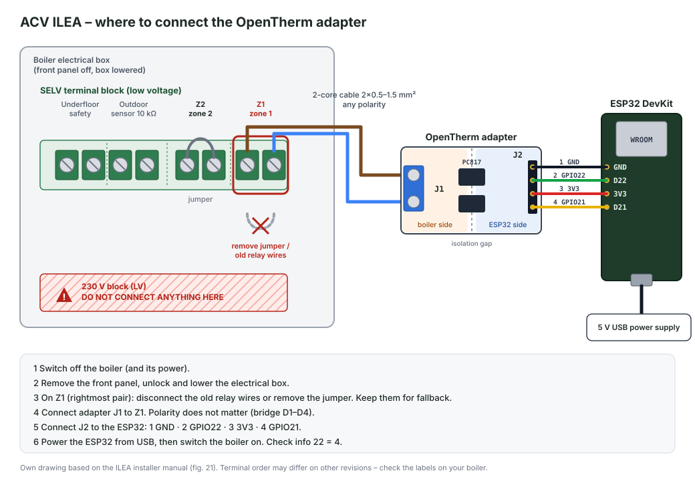

# ACV ILEA (Atlantic Naia 2 platform)

Target unit: **ACV ILEA 18/25**, a combi (CH + DHW) condensing gas boiler. It modulates 4.0–18.5 kW for CH and gives 24 kW for DHW. Built in 2021.

## Compatibility – work in progress

> **Status: WIP, not confirmed on hardware.**
> - Everything below comes from the installer manual (ACV ILEA PL, U0663662, software V16) and related Atlantic/ACV documents.
> - The adapter is being built. The table will be updated with the results of the diagnostic config and the scanner.

| Feature | Status | Evidence / notes |
|---|---|---|
| OpenTherm on the Z1 input | 🟡 likely, unconfirmed | See [Why OpenTherm is likely](#why-opentherm-is-likely) below. |
| Flow setpoint control (TSet, ID 1) | 🟡 expected | This is exactly what the manual describes for Navilink 105/128. Parameter 32 (max flow setpoint zone 1) probably caps it. |
| Max CH setpoint read (ID 57) / ranges (ID 48/49) | ⚪ unknown | To be checked in the scan. |
| Boiler readings: flow, return, modulation, pressure, flue gas | ⚪ unknown | The boiler measures all of them (info menu 1, 4, 6, 11, 15). Whether it reports them over OpenTherm is unknown. |
| Flame / CH / DHW status bits (ID 0) | ⚪ unknown | Expected with any OpenTherm boiler. |
| Outdoor temperature (ID 27) | ⚪ unknown | Only meaningful if a 10 kΩ outdoor sensor is wired to the boiler. |
| DHW setpoint (ID 56) | ⚪ unknown | Read only in this project. |
| Behaviour when the thermostat link is lost | ⚪ unknown | Test step 7. |
| Dry-contact (on/off) control on Z1 | 🟢 works | In use today with a relay. Remove the factory jumper first, see [Terminals](#terminals-selv-block). |

Legend: 🟢 confirmed · 🟡 expected from the documentation · ⚪ unknown, to be tested · 🔴 not supported

### Why OpenTherm is likely

- **The manual describes OpenTherm behaviour.** With Navilink 105 or 128, the flow setpoint is calculated by the room thermostat and passed to the boiler. That is what an OpenTherm master does with TSet (ID 1). "Smart Adapt" on the Navilink computes the setpoint from the difference between room target and actual temperature.
- **The boiler has a dedicated state for these thermostats.** Info item 22 (zone 1 state) has value 4: "room temperature sensor (Navilink 105 / 128)".
- **Navilink 105/125/128 talk OpenTherm.** The Navilink 125/128 manual names OpenTherm as the link to the boiler.
- **Same platform elsewhere.** [gduteil/OpenThermGateway](https://github.com/gduteil/OpenThermGateway) (ESPHome) reportedly runs stably on an Atlantic Naema 2 Micro 25 with Navilink 128.
- **But:** the word "OpenTherm" never appears in the ILEA manual. Some shops list the 18/25 as "OpenTherm: no", and ACV's catalogue only pairs ILEA with Navilink A59 (radio) and Navipass IO (Modbus).

### Boiler features that matter for control

| Feature | Detail | Manual |
|---|---|---|
| Built-in anti-cycling | The boiler waits **at least 3 minutes** between heat demands. | "Zasada działania" |
| Built-in weather curve | Needs the outdoor sensor. Parameter 30 = slope 0.1–4.0 (default 1.2), 31 = offset ±4.5 °C. With Navilink 105/128 the thermostat calculates the setpoint instead. | p. 33, 40 |
| Max flow setpoint zone 1 | Parameter 32, 20–80 °C, default 60 °C. Manual suggests 50 °C for underfloor, 60 °C for low-temperature radiators, 80 °C for classic radiators. | p. 33, 40 |
| Emitter type zone 1 | Parameter 35: 0 = radiators, 1 = underfloor. | p. 40 |
| Transitional-season saving | Parameter 36. **Not compatible** with Navilink 105/128. | p. 40 |
| Software version | Parameter 9. Note it before the test. | p. 39 |

### Other routes (rejected or plan B)

| Route | Why not |
|---|---|
| PASS connector (Navipass IO) | Uses **Modbus** on Naia/Naema (A/B/0V/+24V). No public register map, so it stays plan B. Source: Navipass IO manual 073329. |
| Cloud (Cozytouch/Overkiz) | Almost nothing for Naia 2 in Home Assistant (only DHW and room temperature). Source: home-assistant/core #89537. |

## Terminals (SELV block)

Regenerate the drawing with `python3 boilers/acv-ilea/wiring_diagram.py en boilers/acv-ilea/wiring.svg`.

The SELV terminal block sits under the front panel. Remove the front panel, unlock the electrical box and lower it (manual p. 26, fig. 21). From left to right:

| Position | Function |
|---|---|
| 1st pair | Underfloor heating safety thermostat (normally closed) |
| 2nd pair | Outdoor temperature sensor, 10 kΩ |
| 3rd pair | **Z2**: zone 2 room sensor or thermostat. Factory jumper. |
| 4th pair (rightmost) | **Z1**: zone 1 room sensor or thermostat. Factory jumper. **The adapter goes here.** |

- **Z1 and Z2 come with a factory jumper.** The manual says to remove the jumper before connecting a sensor or thermostat.
- Use flexible cable, max 2 × 1.5 mm². Navilink 105 uses 2 × 0.5–1.5 mm², Navilink 128 uses 2 × 0.75 mm².
- Keep SELV cables apart from the 230 V (LV) cables.
- Never connect anything to the 230 V terminals.
- Older ACV documents number the block 1–10 and include a modem pair. Check the labels on your unit.

## "Info" menu (useful while testing)

| Item | Meaning |
|---|---|
| 1 | Pressure |
| 3 | Outdoor temperature |
| 4 | Flow temperature |
| 5 | Flow setpoint |
| 6 | Return temperature |
| 10 | Boiler state |
| 11 | Modulation |
| 12 | Fan |
| 13 | Ionisation |
| 14 | Burner state |
| 15 | Flue gas |
| 21 | Flow setpoint, zone 1 |
| 22 | Zone 1 state |
| 23 | Room temperature, zone 1 |
| 30–34 | DHW |
| 40–43 | Zone 2 |
| 50–52 | Last fault |
| 60–67 | Energy |

**Info 22 (zone 1 state)** should show **4 ("Navilink 105 / 128")** once the boiler accepts the adapter as an OpenTherm thermostat. The other values: 0 standby, 1 comfort, 2 eco, 3 away, 5–6 temporary override, 7 screed drying, 8 frost protection.

## Test plan

1. Solder the adapter on a dot perfboard and check the netlist (`python3 hardware/board_layout.py`).
2. With a multimeter, check for no continuity between any boiler-side point and the ESP32 GND. Measure the resistors before soldering them.
3. Write down the boiler parameters 9 (software), 30–36 and the info values 5, 21, 22.
4. With the boiler off, remove the old control (relay wires or jumper) from Z1. Turn the boiler on and measure the DC voltage across Z1. Roughly 15–24 V is a good sign but not proof.
5. Flash `opentherm-diagnostic.yaml`, connect the adapter to Z1 with the boiler off, then turn the boiler on. The LEDs should blink.
6. Check info 22, and record which entities get values. Save the logs with the response types (`READ_ACK`, `DATA_INVALID`, `UNKNOWN_DATAID`).
7. Control test: turn "Central heating" on and set "CH flow setpoint" to 40 °C. Expected: flame on, modulation > 0, flow temperature rising.
8. Failure test: disconnect the ESP32 for a few minutes and see what the boiler does (fallback mode or its own control).
9. Afterwards, either restore the old on/off control or switch to `opentherm-weather-curve.yaml`.

Test during the day, in mild weather, and keep it short.

**If the boiler doesn't answer (only timeouts in the logs)**, try these one at a time:
1. swap `in_pin` / `out_pin`;
2. set `inverted: true` on the pins;
3. set `sync_mode: true`.

If it still doesn't answer, this boiler (or its software version) has no OpenTherm. Go back to the on/off contact and update the compatibility table.

## Tuning notes for a condensing setup

- **Goal:** a return temperature below about 45 °C for most of the heating time, and as few burner starts as possible.
- **Start the curve** where the boiler runs today, at a similar flow temperature at +2…+7 °C outside. Then lower it step by step while the house stays warm.
- **Night setbacks:** keep them small (1–1.5 K). A deep setback means hot water in the morning and no condensing.
- **Hydraulics:**
  - open all radiators fully;
  - use a lower pump speed if available, for a bigger flow–return difference;
  - the boiler already enforces a 3-minute minimum pause between heat demands.
